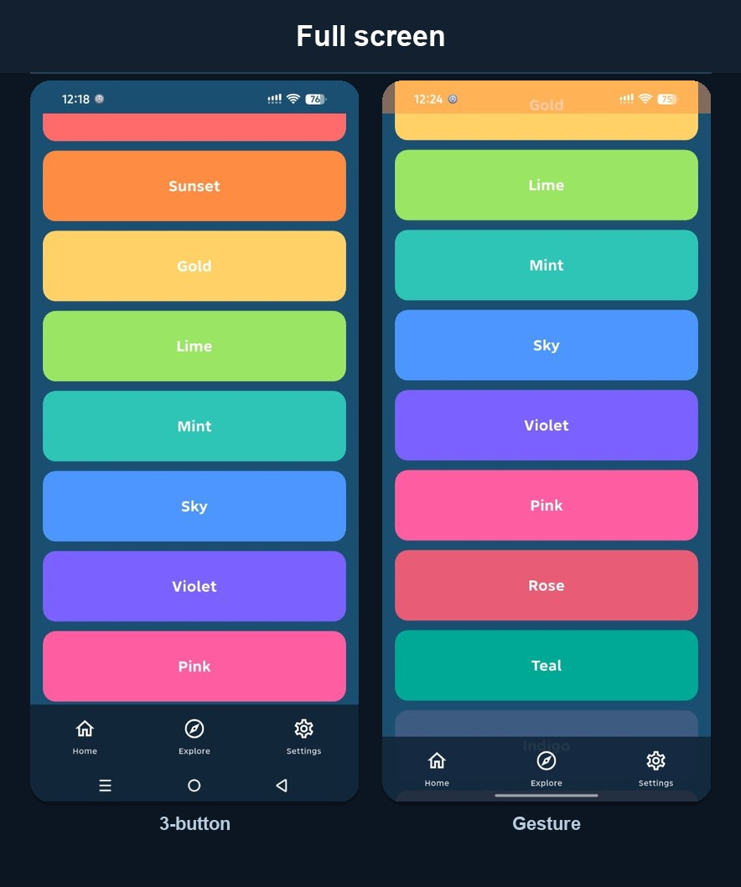
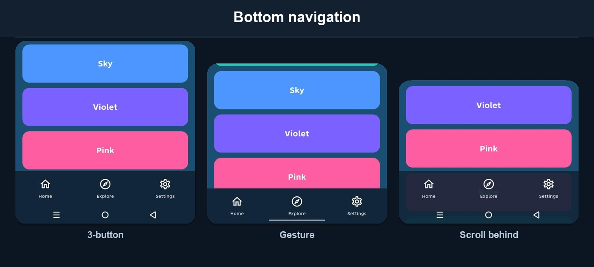
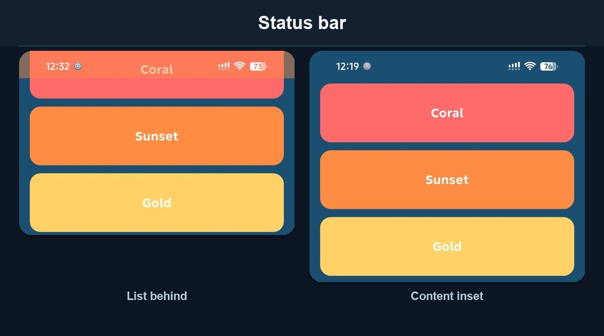

# flutter_smart_safe_area

[](https://pub.dev/packages/flutter_smart_safe_area)
[](https://pub.dev/packages/flutter_smart_safe_area/score)
[](https://pub.dev/packages/flutter_smart_safe_area/score)
[](LICENSE)

**Your buttons never hide under the phone's navigation bar. Your background still fills the whole screen. You write almost no code.**

## What problem does this solve?

Phones have two kinds of bottom navigation:

* **3-button navigation** — Back, Home, and Recents buttons at the bottom of the screen.
* **Gesture navigation** — just a thin line at the bottom (Android gestures and iPhone).

Flutter's normal `SafeArea` treats both the same way. So you either get buttons hidden under the 3 buttons, or an ugly empty gap above the thin line.

This package **looks at the phone and decides for you**:

| The phone has… | Your buttons and text | Your background |
| --- | --- | --- |
| 3 buttons (Back / Home / Recents) | Move up, above the buttons | Fills the whole screen |
| A thin gesture line | Stay at the bottom, no gap | Fills the whole screen |
| iPhone home indicator | Stay at the bottom, no gap | Fills the whole screen |

## It is automatic

The default mode is **`auto`**. You do **not** need to set any parameters. Add the package, do the three steps below, and it works.

### Full screen

On `auto`, content and the tab bar move up on 3-button phones and stay at the bottom on gesture phones.



### Bottom navigation

The tab bar only moves when the phone has 3 buttons. With a see-through color, the list can scroll behind the tab bar.



### Status bar

You can color the top area (where the clock and battery are). A see-through color lets the list slide behind it.



---

## Setup in 3 steps

### Step 1 — Add the package

Run this in your project folder:

```bash
flutter pub add flutter_smart_safe_area
```

### Step 2 — Turn it on in `main.dart`

Copy this whole file. The two lines marked **NEW** are the only changes from a normal Flutter app.

```dart
import 'package:flutter/material.dart';
import 'package:flutter_smart_safe_area/flutter_smart_safe_area.dart';

Future<void> main() async {
  WidgetsFlutterBinding.ensureInitialized();
  await SmartSafeAreaHost.ensureEdgeToEdge(); // NEW
  runApp(const MyApp());
}

class MyApp extends StatelessWidget {
  const MyApp({super.key});

  @override
  Widget build(BuildContext context) {
    return MaterialApp(
      builder: SmartSafeAreaHost.materialBuilder(), // NEW
      home: const HomeScreen(),
    );
  }
}
```

### Step 3 — Use `SmartSafeAreaScaffold` instead of `Scaffold`

```dart
class HomeScreen extends StatelessWidget {
  const HomeScreen({super.key});

  @override
  Widget build(BuildContext context) {
    return SmartSafeAreaScaffold(
      backgroundColor: Colors.blue,
      body: const Center(
        child: Text('I never hide under the navigation bar!'),
      ),
    );
  }
}
```

**That's it.** Your app now handles 3-button, gesture, and iPhone screens by itself.

### Android only: one extra line (recommended)

When someone switches between 3-button and gesture in phone Settings, Android can restart your screen. To stop that, open `android/app/src/main/AndroidManifest.xml`, find `android:configChanges` on your `<activity>`, and add `|assetsPaths` to the end:

```xml
android:configChanges="orientation|keyboardHidden|keyboard|screenSize|smallestScreenSize|locale|layoutDirection|fontScale|screenLayout|density|uiMode|assetsPaths"
```

---

## Common recipes

Copy the one you need.

### Add a bottom tab bar

Pass your tab bar to `bottomNavigationBar`. On 3-button phones it moves up and its color fills under the buttons.

```dart
SmartSafeAreaScaffold(
  backgroundColor: Colors.blue,
  bottomNavigationBar: MyTabBar(),
  body: MyContent(),
)
```

### Color the top and bottom areas

```dart
SmartSafeAreaScaffold(
  backgroundColor: Colors.blue,
  topSafeAreaColor: Colors.orange,    // area behind the clock and battery
  bottomSafeAreaColor: Colors.black,  // area behind the 3 buttons
  body: MyContent(),
)
```

### Make those colors see-through

Opacity goes from `0` (invisible) to `1` (solid). Anything below `1` lets your list scroll **behind** the color.

```dart
SmartSafeAreaScaffold(
  backgroundColor: Colors.blue,
  topSafeAreaColor: Colors.orange,
  topSafeAreaOpacity: 0.5,      // half see-through
  bottomSafeAreaColor: Colors.black,
  bottomSafeAreaOpacity: 0.7,
  body: MyContent(),
)
```

### Hide a color without deleting it

```dart
SmartSafeAreaScaffold(
  topSafeAreaColor: Colors.orange,
  showTopSafeArea: false,       // orange is turned off
  body: MyContent(),
)
```

### Keep the background out of the system areas too

By default the background fills the whole screen. Set this to `false` if you want the background to stop at the safe area as well:

```dart
SmartSafeAreaScaffold(
  extendBackground: false,
  letterboxColor: Colors.black, // color of the empty strips
  backgroundColor: Colors.blue,
  body: MyContent(),
)
```

In this mode the whole screen, background included, always stays clear of the bottom bar.

### Already using `Scaffold`? Keep it

Wrap only the body:

```dart
Scaffold(
  body: SmartSafeArea(
    child: MyContent(),
  ),
)
```

Your existing `SafeArea` widgets also follow the smart rules automatically after Step 2.

### Use it only on Android (or only on iPhone)

Both are on by default. At least one must stay `true`.

```dart
MaterialApp(
  builder: SmartSafeAreaHost.materialBuilder(
    config: const SmartSafeAreaConfig(
      applyOnAndroid: true,
      applyOnIOS: false, // iPhone is left untouched
    ),
  ),
  home: const HomeScreen(),
)
```

### Set colors once for the whole app

Put settings in `SmartSafeAreaConfig` and every screen uses them:

```dart
MaterialApp(
  builder: SmartSafeAreaHost.materialBuilder(
    config: const SmartSafeAreaConfig(
      topSafeAreaColor: Colors.orange,
      topSafeAreaOpacity: 0.5,
    ),
  ),
  home: const HomeScreen(),
)
```

Any screen can still override a value by passing it to `SmartSafeAreaScaffold`.

---

## Bottom behavior: `auto`, `always`, `never`

You almost never need to change this. `auto` is the default.

| Setting | 3-button phone | Gesture phone / iPhone |
| --- | --- | --- |
| `auto` (default) | Content moves up | Content stays at the bottom |
| `always` | Content moves up | Content moves up |
| `never` | Content stays at the bottom | Content stays at the bottom |

Only change it if you have a special reason:

```dart
SmartSafeAreaScaffold(
  bottomBehavior: BottomSafeAreaBehavior.always,
  body: MyContent(),
)
```

---

## All parameters

Every parameter is **optional**. The "Default" column shows what you get if you leave it out.

### Main parameters

| Parameter | Default | What it does |
| --- | --- | --- |
| `bottomBehavior` | `auto` | When content moves up from the bottom. See the table above. |
| `extendBackground` | `true` | `true`: background fills the whole screen. `false`: background stops at the safe area too. |
| `letterboxColor` | background color | Color of the empty strips when `extendBackground` is `false`. |
| `applyOnAndroid` | `true` | Turn the package on or off for Android. |
| `applyOnIOS` | `true` | Turn the package on or off for iPhone and iPad. |

### Colors for the system areas

Replace `top` with `bottom`, `left`, or `right` for the other sides.

| Parameter | Default | What it does |
| --- | --- | --- |
| `topSafeAreaColor` | none | Paints the area behind the clock and battery. |
| `topSafeAreaOpacity` | `1` | `0` = invisible, `1` = solid. Below `1`, the list scrolls behind it. |
| `showTopSafeArea` | `true` | `false` turns the color off without removing it. |

### Which sides to protect

| Parameter | Default | What it does |
| --- | --- | --- |
| `applyTop` | `true` | Keep content below the status bar. |
| `applyBottom` | `true` | Keep content above the navigation bar (follows `bottomBehavior`). |
| `applyLeft` / `applyRight` | `true` | Keep content away from side notches in landscape. |

On `SmartSafeAreaScaffold` and `SmartSafeArea`, these are called `top`, `bottom`, `left`, and `right`.

### Advanced (you usually don't need these)

| Parameter | Default | What it does |
| --- | --- | --- |
| `keyboardAware` | `false` | Content moves up above the keyboard. |
| `minimum` | `EdgeInsets.zero` | Smallest space to keep on each side. |
| `extraPadding` | `EdgeInsets.zero` | Extra space added on top of the safe area. Called `extra` on widgets. |
| `threeButtonNavThreshold` | `40` | Bottom size (in dp) that counts as 3-button navigation. |
| `adaptExistingSafeArea` | `true` | Makes Flutter's normal `SafeArea` follow the smart rules. |
| `enableEdgeToEdge` | `true` | Makes the system bars transparent so the background can show behind them. |

---

## Extra tools

### Test 3-button vs gesture without a real phone

Wrap your app to pretend it is a 3-button or gesture phone. Handy on the iOS Simulator or desktop.

```dart
SmartSafeAreaSimulator(
  nav: SimulatedSystemNav.threeButton, // or .gesture, .none
  child: MyApp(),
)
```

### Read the numbers yourself

```dart
final insets = context.smartSafeArea;   // the calculated spaces
final mode = context.systemNavMode;     // threeButton, gesture, or none

Padding(
  padding: EdgeInsets.only(bottom: insets.contentBottom),
  child: MyWidget(),
)
```

### How it decides

It measures the space at the bottom of the screen:

| Bottom space | It thinks the phone has… | Content moves up? |
| --- | --- | --- |
| 40 dp or more | 3 buttons | Yes |
| More than 0, less than 40 dp | Gesture line / iPhone | No |
| 0 | Nothing | No |

When the user changes navigation in phone Settings and comes back to your app, it checks again automatically.

---

## Widgets in this package

| Widget | Use it for |
| --- | --- |
| `SmartSafeAreaHost` | Turn the package on for the whole app (Step 2). |
| `SmartSafeAreaScaffold` | A `Scaffold` that handles safe areas for you (Step 3). |
| `SmartSafeArea` | A smarter replacement for Flutter's `SafeArea`. |
| `SmartSystemNavBar` | A bottom bar that fills under the 3 buttons. Added for you by `SmartSafeAreaScaffold`. |
| `SmartSafeAreaConfig` | App-wide settings. |
| `SmartSafeAreaSimulator` | Pretend to be a 3-button or gesture phone while testing. |

## Example app

See the [example app](https://github.com/TalhaRiazH/flutter_smart_safe_area/tree/main/example) on GitHub: a colorful list, a tab bar, and colored top and bottom areas.

## Help and bugs

Found a problem? Open an issue at [TalhaRiazH/flutter_smart_safe_area](https://github.com/TalhaRiazH/flutter_smart_safe_area/issues).

## License

MIT. See [LICENSE](LICENSE).

Full API reference: [pub.dev documentation](https://pub.dev/documentation/flutter_smart_safe_area/latest/).
